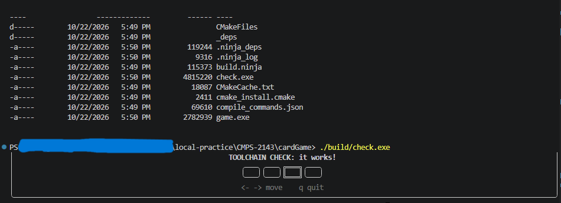
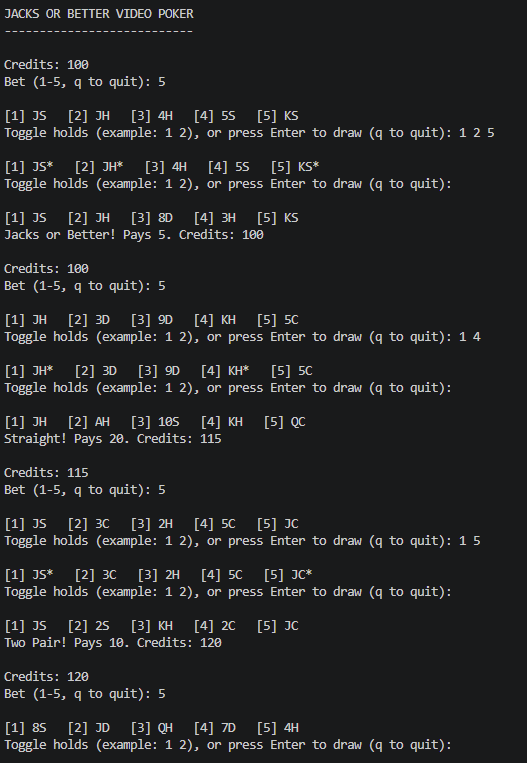
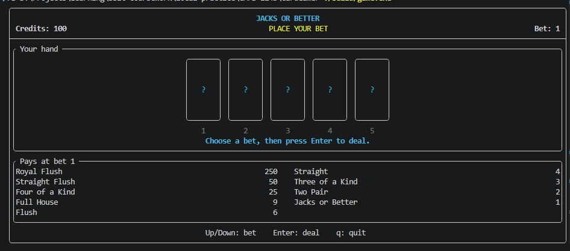
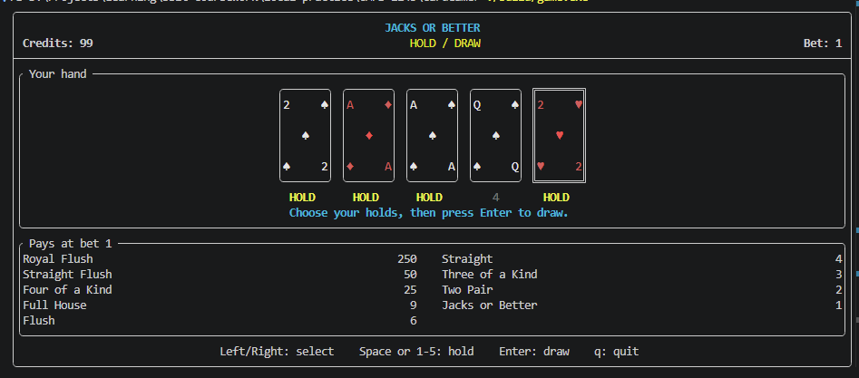
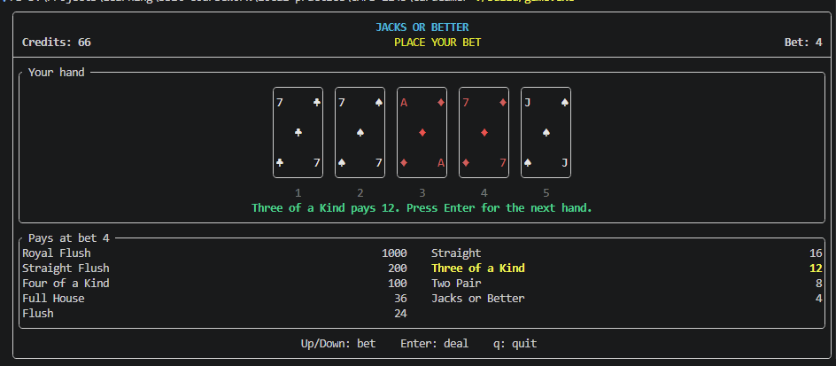

# P01 - Video Poker

I chose Jacks or Better video poker. You start with 100 credits and can bet
1 to 5 credits each hand. After the cards are dealt, you choose which ones
to hold and draw new cards for the rest. The game checks your final hand
and adds any winnings to your credits.

## How to build

From the main repository folder, run these commands in PowerShell.
These use an MSYS2 UCRT64 installation at C:\msys64:

    cd Assignments/P01
    C:\msys64\ucrt64\bin\cmake.exe -S . -B build -G Ninja -DCMAKE_CXX_COMPILER=C:/msys64/ucrt64/bin/c++.exe -DCMAKE_MAKE_PROGRAM=C:/msys64/ucrt64/bin/ninja.exe
    C:\msys64\ucrt64\bin\cmake.exe --build build

MSYS2 needs the UCRT64 C++ compiler, CMake, and Ninja installed.
If MSYS2 is installed somewhere else, change C:/msys64 in the commands.
The first build needs internet to download FTXUI.
VS Code settings are only for editing and are not needed to build or run.

## How to run

Run the terminal version with cards and colors:

    .\build\game.exe

Run the plain text version:

    .\build\game.exe --text

Run the tests:

    .\build\game.exe --test

Run the starter toolchain check:

    .\build\check.exe

## How to play

In the terminal version, use Up and Down to change your bet and Enter to
deal. Use Left and Right to select a card, then Space to hold it. You can
also use 1-5 to hold cards. Press Enter again to draw. Press q to quit.

In the text version, type your bet, then type card numbers like 1 2 to
hold those cards. Press Enter without typing anything to draw. Type q
to quit.

## How the code works

Hand stores the cards. VideoPoker handles the rules, credits, holds, and
payouts. ConsoleView and TuiView show the game and handle input. Both use
the same VideoPoker class. GameView lets main pick which view to run.

The tests use set decks so the cards come out in a known order. They
check the hands and payouts, including the 4000-credit royal flush at
a bet of 5. The tests cover the required hands, royal flush payouts, and holding cards.

The terminal card layout uses ideas from rugbyprof's Resources/ftxui/main.cpp
and the colors and layout examples. It adds bigger cards and yellow HOLD labels.

## Screenshots

### Toolchain check

### Text version

### Terminal version during a hand

## Known issues

No gameplay problems showed up in testing. The suit symbols do not show
in my toolchain screenshot, but they do show in the game screenshots.

## Starter files and examples

These files came from [rugbyprof's P01 starter](https://github.com/rugbyprof/2143-Object-Oriented-Programming/tree/master/Assignments/P01/starter)
and were left unchanged: Card.hpp, Card.cpp, Deck.hpp, Deck.cpp, GameView.hpp,
CMakeLists.txt, and check/check.cpp.

The drawCard helper in TuiView.cpp adapts the corner ranks, center suit,
selection border, and HOLD layout from
[his FTXUI card demo](https://github.com/rugbyprof/2143-Object-Oriented-Programming/blob/master/Resources/ftxui/main.cpp).
The colors and panels also use techniques from his 01_colors.cpp and
06_layout.cpp examples.

Hand, VideoPoker, ConsoleView, Tests, and the game-specific TuiView code
were added for this project with AI assistance. Their interfaces follow the
assignment's suggested design. main.cpp was rewritten from the starter
to choose the view or run the tests.

The FTXUI headers are part of the FTXUI library downloaded by CMake.
No SDL3 PNG or SVG images are used in this terminal version.
The build folder is not included in the submission.
